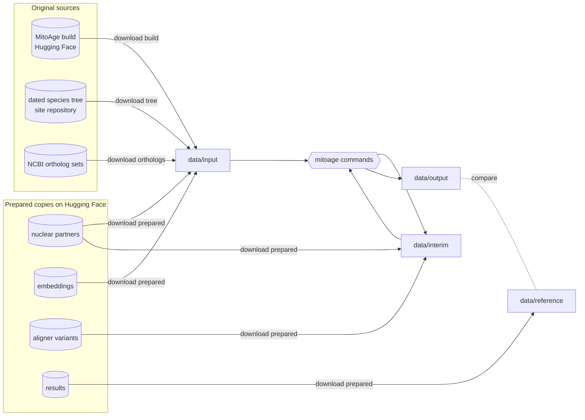
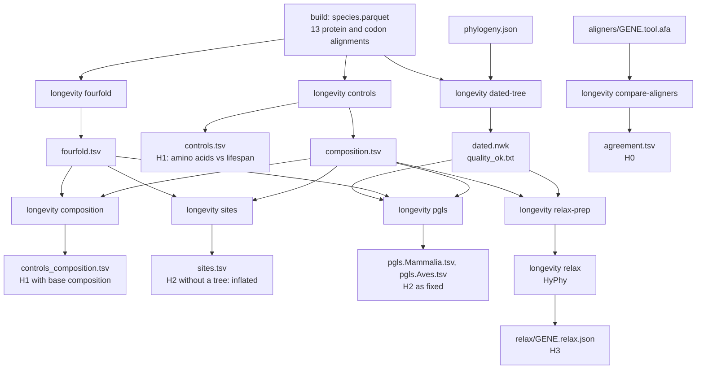
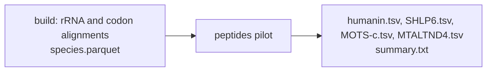
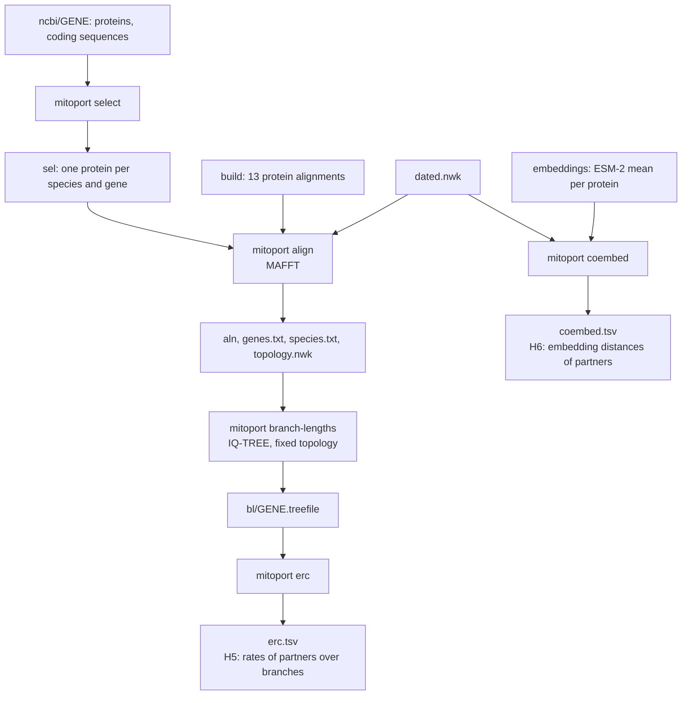

# The pipeline in pictures

What is downloaded, which command reads and writes what, and which table each finding is read from.
Hypotheses (H0 to H6), their tests and results are in [HYPOTHESES.md](HYPOTHESES.md).

## Where the data comes from

Two ways in: fetch from the original sources and run every step, or fetch our prepared copies and start
anywhere. `data/reference` holds our result tables; a rerun writes `data/output`, and the two can be compared
file by file.

## Longevity in the mitochondrial proteins (H0 to H3)

Every model that tests lifespan carries body mass and base composition at fourfold-degenerate sites; every
step that needs a tree takes the dated species tree, and only lifespan records of high or acceptable quality.

## Peptides encoded inside mtDNA (H4)

For each published peptide: find it in the human row, project its columns onto every species, ask for a
start codon and an open frame; compare with other windows of the same gene that are open in human.

## Mitochondrial and nuclear partners: mitoport (H5, H6)

Both tests compare nuclear subunits of complexes III and IV with three kinds of control: cytosolic
proteins, complex II (which has no mitochondrially encoded subunit) and mitochondrial matrix enzymes.
